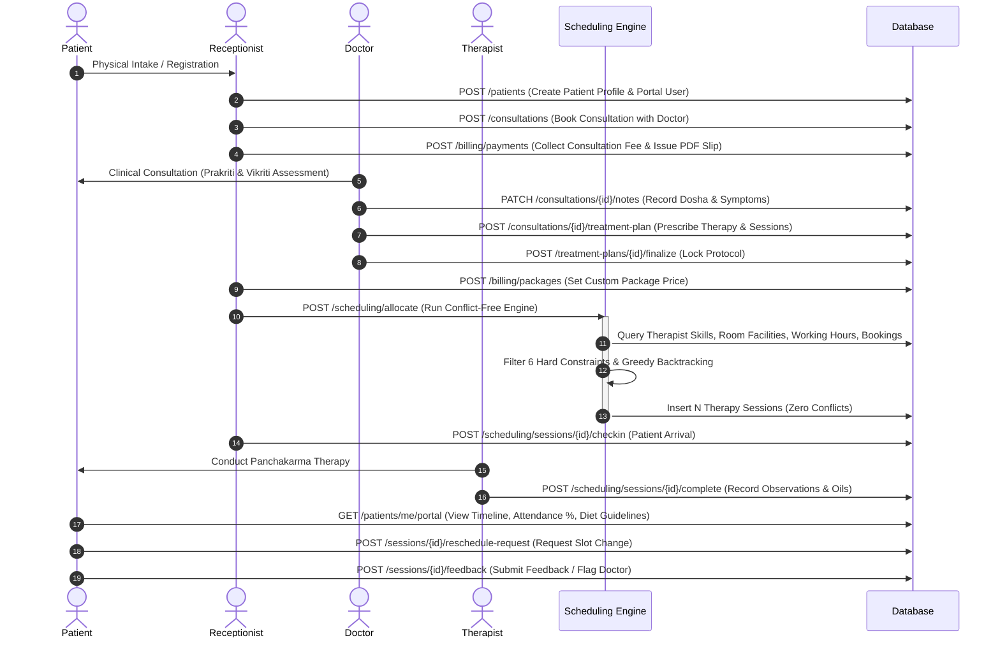
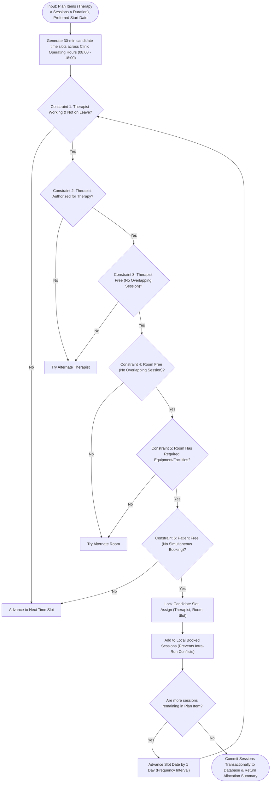
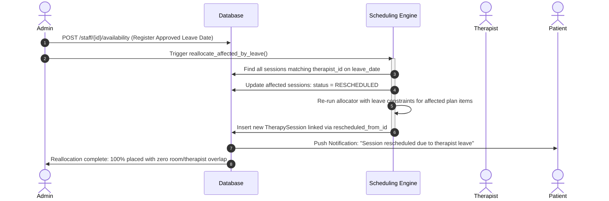

# AyurSutra — Workflow Diagrams

## 1. End-to-End Clinical & Commercial Lifecycle

---

## 2. Multi-Session Scheduling Engine Constraint Pipeline

---

## 3. Therapist Leave & Automated Reallocation Workflow

